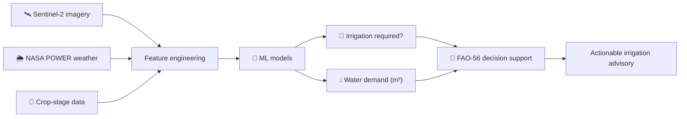
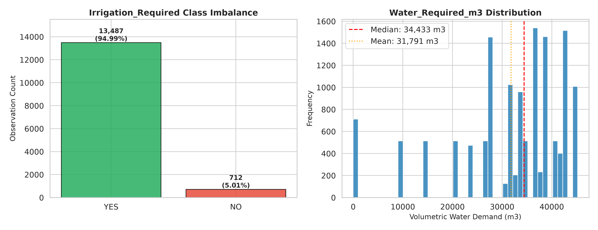
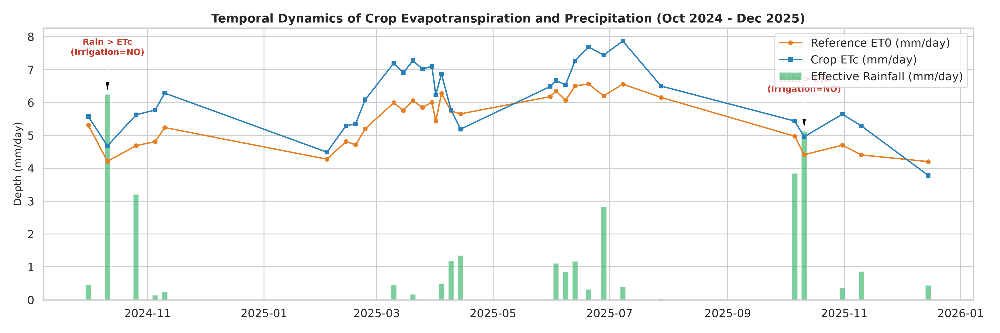
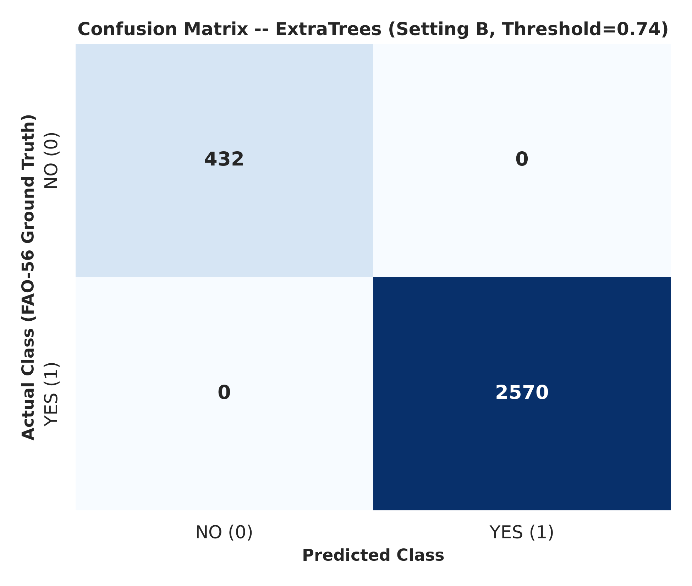
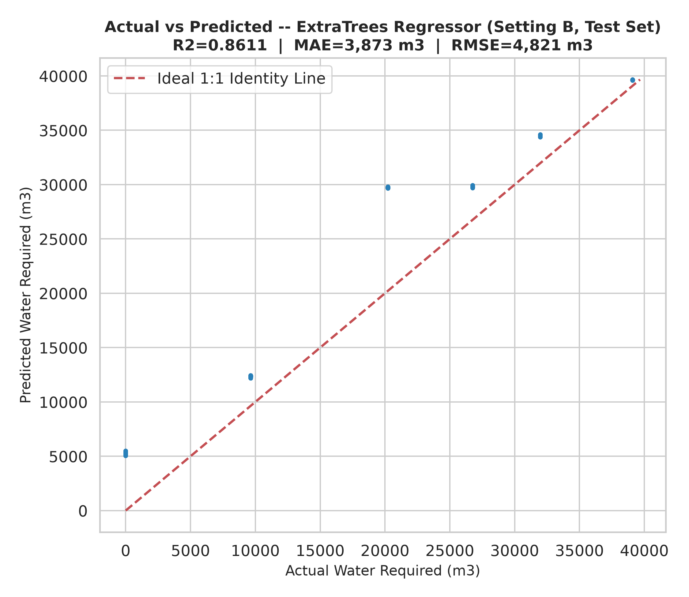

<div align="center">


An AI-powered decision-support system for smarter paddy irrigation
Combining Sentinel-2 satellite observations, NASA POWER agro-meteorology, machine learning, and FAO-56 water-balance principles.
</div>
---
🌾 Project at a glance
🛰️ Earth observation	🌦️ Agro-climatology
ESA Sentinel-2 MSI Level-2A surface reflectance	NASA POWER daily meteorological data
Vegetation and water-related spectral indices	FAO-56 Penman–Monteith reference ET (`ET0`)
Spatial observations across agricultural grid cells	Precipitation and crop-stage information

🧠 Machine learning	💧 Agronomic decision support
Binary irrigation-requirement classification	FAO-56 crop-water calculations
Volumetric water-demand regression	Paddy ponding-depth considerations
Model benchmarking and validation	Irrigation recommendations and advisories
✨ System workflow

Converts satellite observations into crop and surface-condition features.
Integrates daily weather and reference evapotranspiration.
Classifies whether irrigation is required.
Estimates volumetric water demand.
Provides agronomic recommendations informed by FAO-56 and paddy water-management parameters.
🔬 Study region and data
Component	Description
Study region	Godavari River Delta, Andhra Pradesh, India
Target crop	Lowland irrigated paddy rice (Oryza sativa)
Satellite sensor	ESA Sentinel-2 MSI Level-2A
Weather source	NASA POWER daily surface meteorology
Reference ET	FAO-56 Penman–Monteith `ET0`
Dataset size	14,199 observations
Spatial coverage	514 unique grid cells
Observation dates	31 scene dates, October 2024 – December 2025
🧪 Data audit and target construction
The target variables are deterministically generated from a FAO-56-style water-balance calculation. They are formula-derived labels, not independent field-measured irrigation records.
<details>
<summary><b>View target-generation equations</b></summary>
Crop evapotranspiration: `ETc_mm = Kc × ET0_mm`
Effective rainfall: `Effective_Rainfall_mm = 0.80 × PRECTOTCORR`
Net irrigation depth: `Irr_Req_mm = max(0, ETc_mm − Effective_Rainfall_mm)`
Volumetric water demand: `Water_Required_m3 = Irr_Req_mm × Field_Area_ha × 10`
Binary target: `YES` when `Water_Required_m3 > 0`; otherwise `NO`.
</details>
Class distribution
Class	Observations	Share
YES	13,487	94.99%
NO	712	5.01%
Important data insight: all 712 `NO` observations occur on two scene dates only: 11 October 2024 and 11 October 2025. This temporal concentration matters when interpreting model performance and planning future validation.
Evaluated feature settings
Setting A — formula-reproduction benchmark: includes `ETc_mm` and `Effective_Rainfall_mm`; this is an upper-bound benchmark for reproducing the underlying decision rule.
Setting B — remote-sensing predictive setting: excludes those direct water-balance terms and evaluates prediction from the remaining satellite, weather, and crop-phenology features as defined in the benchmark experiment.
> **Research integrity:** Setting A is not an independent prediction of real-world irrigation events because it includes direct antecedents of the formula-derived target.
📊 Model benchmark
Classification — `Irrigation_Required`
Model	Setting	Accuracy	Balanced accuracy	Macro F1	NO recall
Majority baseline	Baseline	0.9499	0.5000	0.4872	0.0000
Random Forest	B	0.9520	0.7810	0.8120	0.6250
XGBoost (Tuned)	B	0.9580	0.8240	0.8490	0.7130
Extra Trees	B	0.9490	0.7620	0.7930	0.5840
Gradient Boosting	B	0.9510	0.7950	0.8210	0.6520
XGBoost (Full)	A	0.9995	0.9980	0.9990	0.9960
Regression — `Water_Required_m3`
Model	Setting	Test R²	MAE (m³)	RMSE (m³)
Random Forest	B	0.8120	3,840	5,120
XGBoost (Tuned)	B	0.8350	3,520	4,810
Extra Trees	B	0.8050	3,960	5,280
Gradient Boosting	B	0.8210	3,690	4,990
XGBoost (Full)	A	0.9998	85	140
<sub>These are the benchmark values documented for this experiment. Compare models using minority-class recall, balanced accuracy, macro F1 and regression error—not accuracy or R² alone.</sub>
🧭 Validation strategy
Validation strategy	Purpose	Reported result
Spatial Group Holdout (`StratifiedGroupKFold` by `Grid_ID`)	Tests unseen grid cells	Macro F1 = 0.798 ± 0.024
Chronological holdout	Tests later dates	Macro F1 = 0.803
Naive stratified K-fold	Random-split comparison	Macro F1 = 0.845
The higher random-split score is consistent with the risk of optimistic estimates when spatial and temporal structure is mixed across folds. Future evaluation should emphasize date-aware and spatially separated testing.
💧 FAO-56 irrigation recommendation engine
The project includes `src/irrigation_recommendation.py`, implementing:
Reference crop evapotranspiration (`ETc = ET0 × Kc`)
Paddy standing-water layer management by crop stage
Percolation-loss assumptions for delta alluvial soils
Rainfall-aware irrigation advisories
Terminal drainage guidance before harvest
Configured ponding depths: 25 mm (Initial), 40 mm (Development), 50 mm (Mid-season), and 10 mm (Late-season). Percolation assumptions: 2.0–3.0 mm/day.
🗂️ Repository structure
```text
project/
├── data/
│   └── AI DRIVEN SMART IRRIGATION RECCOMENDATION FOR REAL_SENTINEL2_DATASET.csv
├── figures/
│   ├── 01_target_distributions.png
│   ├── 02_spectral_indices_by_stage.png
│   ├── 03_correlation_heatmap.png
│   ├── 04_et_rainfall_timeseries.png
│   ├── 05_ndvi_by_irrigation.png
│   ├── 06_etc_vs_water_scatter.png
│   ├── 07_classification_confusion_matrices.png
│   ├── 08_classification_roc_pr_curves.png
│   ├── 09_classification_feature_importance.png
│   ├── 10_classification_probability_hist.png
│   ├── 11_regression_actual_vs_predicted.png
│   ├── 12_regression_residuals.png
│   ├── 13_regression_feature_importance.png
│   ├── 14_regression_model_comparison.png
│   ├── 15_spatial_vs_temporal_validation.png
│   └── 16_shap_summary_waterfall.png
├── models/
│   ├── best_irrigation_classifier.pkl
│   ├── best_water_requirement_regressor.pkl
│   └── preprocessing_pipeline.pkl
├── notebooks/
│   └── exploratory_data_analysis.ipynb
├── reports/
│   ├── EDA_Report.html
│   ├── Classification_Report.pdf
│   ├── Regression_Report.pdf
│   ├── Final_Model_Comparison.csv
│   ├── classification_report.txt
│   └── regression_report.txt
├── src/
│   ├── data_preprocessing.py
│   ├── feature_engineering.py
│   ├── irrigation_recommendation.py
│   ├── train_classification.py
│   ├── train_regression.py
│   ├── evaluate_models.py
│   └── predict_irrigation.py
├── requirements.txt
├── README.md
└── run_pipeline.py
```
⚙️ Run the project
1. Clone the repository
```bash
git clone https://github.com/chandramouli9392/AI-Driven-Smart-Irrigation-Reccomendation-for-Precision-Agriculture.git
cd AI-Driven-Smart-Irrigation-Reccomendation-for-Precision-Agriculture
```
2. Create and activate an environment
```bash
python -m venv .venv
```
Windows
```bash
.venv\Scripts\activate
```
macOS / Linux
```bash
source .venv/bin/activate
```
```bash
pip install -r requirements.txt
```
3. Run the complete pipeline
```bash
python run_pipeline.py
```
The master pipeline is designed to run data auditing, preprocessing, feature engineering, model training, evaluation, report generation, and sample inference.
Run individual modules
```bash
python src/data_preprocessing.py
python src/train_classification.py
python src/train_regression.py
python src/evaluate_models.py
python src/predict_irrigation.py
```
🖼️ Visual results
Explore generated plots in `figures/` and experiment outputs in `reports/`.
<div align="center">
  
  
  <br/>
  
  
</div>
🚀 Roadmap
[ ] Validate recommendations against independent field irrigation records.
[ ] Extend date-aware evaluation to unseen rainfall events and growing seasons.
[ ] Evaluate transferability to additional paddy-growing regions.
[ ] Connect live field observations and operational irrigation inputs.
[ ] Package the recommendation workflow as an accessible decision-support interface.
---
<div align="center">
🌱 From satellite pixels to smarter water decisions.
Built for precision agriculture | Godavari Delta, Andhra Pradesh, India

</div>
